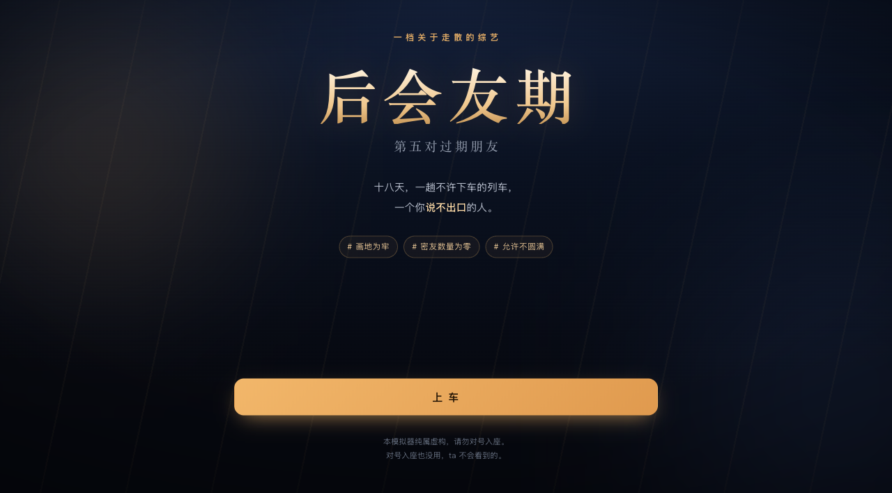
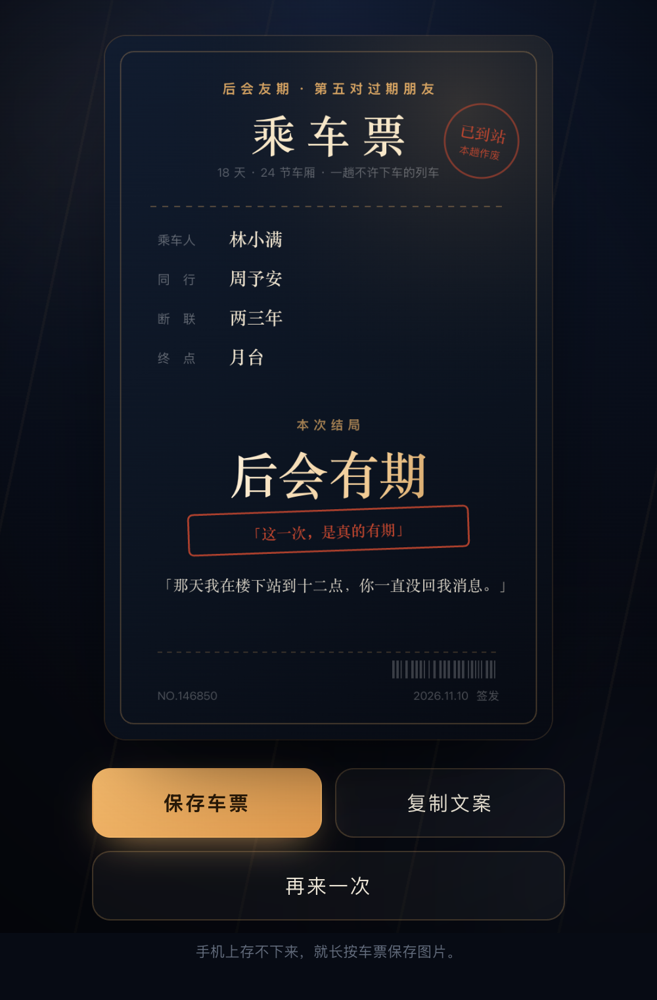

# 后会友期 · 第五对过期朋友

在线玩：https://houhuiyouqi-production.up.railway.app

一个网页版「后会有期模拟器」。十八天，一趟不许下车的列车，一个你说不出口的人。

登记录入你和那个人的名字、断联多久、当年卡在哪件事上，然后坐上这趟车——七场戏，每场四种说法，五种结局，最后生成一张属于你的车票。



## 玩

打开 [index.html](index.html) 即可，单文件、零依赖、手机也能玩。

## 玩法

- **登记**：名字 / 断联多久 / 当年是因为什么 / 一句没说出口的话
- **七场戏**：车厢 → 餐车 → 凌晨过道 → 中途站台 → 最后一节车厢 → 采访间 → 终点站月台
- **四个说法**：真心话 / 撑面子 / 阴阳怪气 / 装没听见
- **观察室**：三个虚拟观察员会根据你的数值点评你，还有弹幕
- **五种结局**：后会有期、体面收口、画地为牢、各自下车、名场面
- **车票**：结局生成一张车票，可以保存成图片发出去



## 关于

纯虚构，请勿对号入座。对号入座也没用，ta 不会看到的。

背景音乐是浏览器 Web Audio 现场合成的（没有音频文件），右上角 ♪ 可以关掉。

## 本地运行

```bash
python3 server.py     # http://localhost:8080
```

或者直接双击 index.html。

## 部署

Railway 直接识别 `Procfile`，`python3 server.py` 起一个静态服务。

- 起始命令：`web: python3 server.py`
- 端口：读取 `$PORT`，默认 8080
